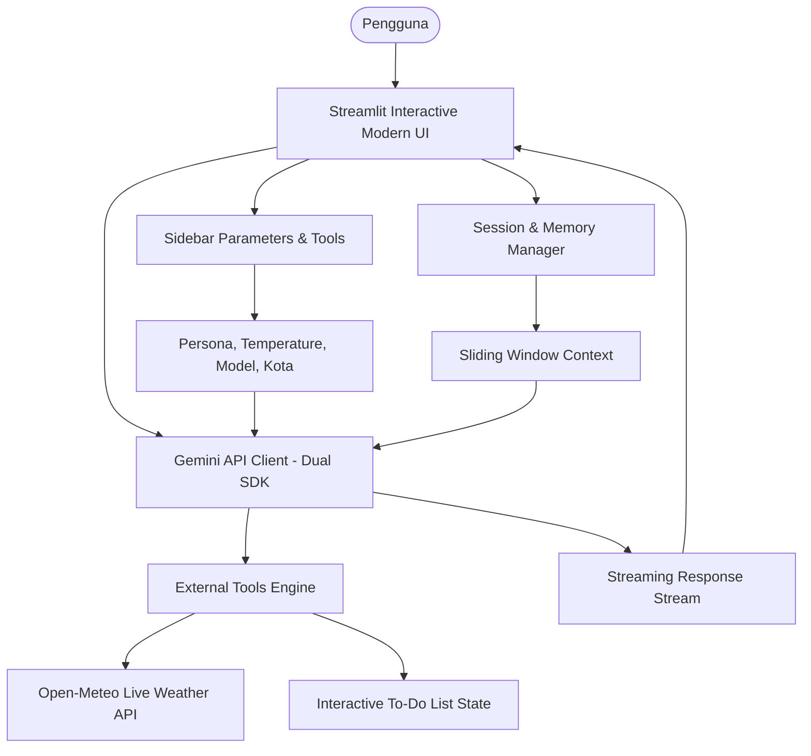

# ⚡ AURA: AI Personal Productivity & Life Assistant

> **Final Project: LLM-Based Tools and Gemini API Integration for Data Scientists**  
> *Hacktiv8 Indonesia*

[](https://www.python.org/)
[](https://streamlit.io/)
[](https://aistudio.google.com/)
[](LICENSE)

---

## 📌 1. Deskripsi & Latar Belakang Proyek

**AURA (Autonomous Utility & Resilience Assistant)** adalah *chatbot* asisten produktivitas harian berbasis kecerdasan buatan (AI) yang dirancang khusus untuk membantu mahasiswa, data scientist, dan profesional dalam mengatasi *cognitive overload* (kelelahan mental akibat banyaknya tugas dan agenda).

Berbeda dari chatbot biasa yang bersifat pasif, AURA bertindak sebagai **Life Copilot interaktif** yang berorientasi pada tindakan nyata (*action-oriented*):
- Menyesuaikan gaya komunikasi dengan kebutuhan kerja melalui berbagai pilihan persona.
- Menyediakan *Daily Morning Briefing* terintegrasi data cuaca *real-time*.
- Mengelola daftar tugas (*to-do list*) interaktif yang terhubung langsung di samping sesi obrolan.
- Mendukung pemecahan masalah data science dan penyusunan prioritas kerja berbasis metode *Eisenhower Matrix* dan teknik *Pomodoro*.

---

## ✨ 2. Fitur Utama & Parameter Kreatif

### 🎭 Parameter Kreatif 1: Multi-Persona & Gaya Bahasa
Pengguna dapat memilih karakter asisten sesuai suasana hati atau konteks kerja:
* 💼 **Executive Assistant**: Formal, tajam, padat, berorientasi hasil (*results-driven*), dan minim basa-basi.
* ☕ **Casual Buddy**: Santai, hangat, suportif, dan bersahabat layaknya rekan kerja yang akrab.
* ⏱️ **Productivity Coach**: Disiplin, to-the-point, anti-prokrastinasi, dan berfokus pada eksekusi tugas (*time-blocking* & *Pomodoro*).

### 🎛️ Parameter Kreatif 2: Suhu & Kreativitas (Temperature Slider)
Pengaturan dinamis dari `0.0` hingga `1.0`:
* **0.0 - 0.3 (Strict / Precision)**: Jawaban lebih faktual, terstruktur, dan deterministik (cocok untuk analisis teknis dan to-do list).
* **0.7 - 1.0 (Creative / Brainstorming)**: Jawaban lebih eksploratif, variatif, dan kaya ide (cocok untuk mencari solusi kreatif atau ide proyek).

### 🌤️ Integrasi Tools Eksternal: Live Weather API
* Menggunakan **Open-Meteo Live Weather API** (gratis, tanpa limitasi key) untuk mengambil kondisi cuaca, suhu, dan kecepatan angin kota secara *real-time*.
* Informasi cuaca otomatis disuntikkan (*augmented context*) ke dalam sistem asisten untuk memberikan saran aktivitas harian yang relevan.

### 📋 Interactive Task & Agenda Tracker
* Panel to-do list dinamis di *sidebar* yang memungkinkan pengguna mencentang tugas yang selesai atau menambahkan tugas baru kapan saja.
* Status tugas aktif otomatis dibagikan ke memori AURA agar asisten selalu sadar akan beban kerja pengguna.

### ⚡ Quick Action Prompts (1-Click)
Tombol jalan pintas untuk kebutuhan rutin harian:
* 🌅 **Morning Briefing**: Rekap rencana dan rekomendasi hari ini berdasarkan cuaca.
* 🎯 **Prioritaskan Tugas**: Evaluasi pekerjaan menggunakan matriks penting vs mendesak (*Eisenhower Matrix*).
* ⏳ **Sesi Pomodoro 25 Menit**: Rencana fokus kerja intensif 25 menit.
* 💡 **Ide Data Science**: Brainstorming 3 ide proyek data science yang siap diimplementasikan.

### 💾 Memory & Export Sesi
* Mekanisme memori riwayat obrolan *multi-turn* dengan *sliding window buffer*.
* Tombol **Ekspor Percakapan** ke format Markdown (`.md`) untuk dokumentasi atau catatan belajar.

---

## 🏛️ 3. Arsitektur Sistem



---

## 📂 4. Struktur Direktori Proyek

```
Personal Assistant Bot/
├── .env.example              # Template konfigurasi environment
├── .gitignore                # Mengabaikan file sensitif (.env, venv, pycache)
├── requirements.txt          # Daftar dependencies Python
├── README.md                 # Dokumentasi proyek lengkap
├── app.py                    # Aplikasi utama Streamlit & antarmuka modern
├── core/
│   ├── __init__.py           # Paket modul core
│   ├── config.py             # Definisi persona, prompt, dan quick actions
│   ├── gemini_client.py      # Integrasi Gemini API (google-genai / google-generativeai)
│   ├── memory.py             # Pengelolaan riwayat pesan & ekspor chat
│   └── tools.py              # Tool cuaca Open-Meteo & To-Do List manager
└── assets/
    └── ui_screenshot.png     # Tangkapan layar antarmuka aplikasi (< 1MB)
```

---

## 🚀 5. Panduan Instalasi & Menjalankan Aplikasi

### Prasyarat
* Python versi 3.10 atau yang lebih baru.
* Google Gemini API Key (dapat diperoleh secara gratis di [Google AI Studio](https://aistudio.google.com/)).

### Langkah-langkah:

1. **Clone Repositori:**
   ```bash
   git clone https://github.com/<username-anda>/personal-assistant-bot.git
   cd personal-assistant-bot
   ```

2. **Buat & Aktifkan Virtual Environment (Opsional namun disarankan):**
   ```bash
   python -m venv venv
   # Windows:
   venv\Scripts\activate
   # macOS/Linux:
   source venv/bin/activate
   ```

3. **Install Dependensi:**
   ```bash
   pip install -r requirements.txt
   ```

4. **Konfigurasi Environment Variable:**
   Salin `.env.example` menjadi `.env`:
   ```bash
   cp .env.example .env
   ```
   Buka file `.env` dan masukkan API key Anda:
   ```env
   GEMINI_API_KEY=AIzaSy...
   DEFAULT_CITY=Jakarta
   ```
   *(Catatan: Anda juga bisa memasukkan API Key langsung melalui kolom di sidebar web aplikasi).*

5. **Jalankan Aplikasi:**
   ```bash
   python -m streamlit run app.py
   ```
   Buka peramban (browser) di alamat: `http://localhost:8501`.

---

## 📝 6. Data Pengumpulan Final Project Hacktiv8

| Pertanyaan Google Form | Jawaban |
| :--- | :--- |
| **Nama project** | **AURA: AI Personal Productivity & Life Assistant** |
| **Siapa target pengguna chatbot Anda?** | Mahasiswa, data scientist, dan pekerja profesional yang menghadapi *cognitive overload* dalam mengelola rutinitas harian, jadwal, to-do list, dan membutuhkan pendamping produktivitas adaptif. |
| **Bagaimana chatbot Anda dapat membantu pengguna?** | 1. Mengubah percakapan bahasa alami menjadi aksi nyata (to-do list interaktif & penentuan prioritas kerja otomatis).<br>2. Menyajikan *Daily Morning Briefing* terintegrasi live cuaca real-time (Open-Meteo API).<br>3. Menyesuaikan gaya komunikasi via persona fleksibel (*Executive Assistant*, *Casual Buddy*, *Productivity Coach*).<br>4. Membantu brainstorming & riset kerja dengan kontrol parameter suhu/kreativitas (*creative parameters*).<br>5. Menyimpan memori obrolan multi-turn agar konteks tugas tetap konsisten. |
| **Link Github** | *(Cantumkan link repositori GitHub Anda)* |
| **UI (User Interface) chatbot** | File `assets/ui_screenshot.png` (resolusi tinggi, ukuran < 1 MB). |
| **Izin Publikasi** | **Ya, saya setuju** |

---

## 👨‍💻 Kontributor
* Final Project - LLM-Based Tools and Gemini API Integration for Data Scientists (Hacktiv8 Indonesia).
